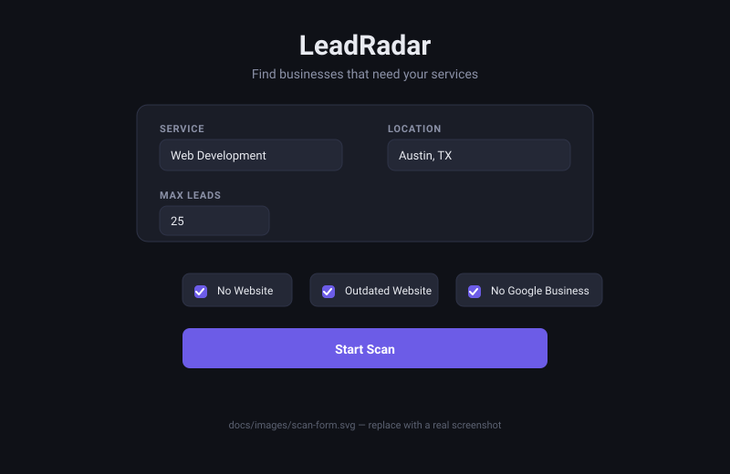
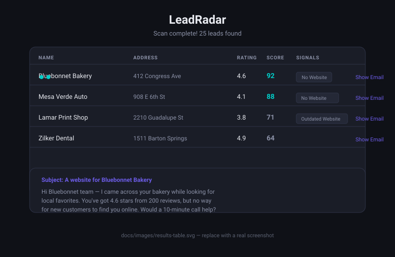

<div align="center">
  <h1>LeadRadar</h1>
  <p><strong>Find the businesses that need you, before they know they need you.</strong></p>
  <p>An open-source AI agent that scans local businesses, spots the ones that need your service,<br/>and writes the first email for you.</p>
  <p>
    
    
    
    
    
    
    
    
    
  </p>
  <p><em>Built for the Hacktoberfest 2026 Open-Source AI Challenge — Week 2: Side Hustle</em></p>
</div>

---

## The problem

Freelancers are good at their craft and terrible at finding people who need it.

My friend David designs websites. He's brilliant at it. But every Monday morning I watch him do the
same thing: pull up Google Maps, scroll through a few hundred businesses, squint at ratings, open
tabs, and read through them one at a time to figure out which ones actually need help. Three hours
in, he has a list of eleven businesses and a headache.

The work isn't hard. It's just *slow*, and it's exactly the kind of slow a model should do.

So I built LeadRadar, and gave it the boring half of his job.

## What it does

You tell it two things: **what you do** and **where you do it**. LeadRadar handles the rest.

1. **Finds local businesses** through SerpApi — real Google Maps data, not stale directories.
2. **Reads each one like a prospector would.** It checks for a missing website and a poor review
   history, scores every business 0–100 on how badly they need your service, and says *why*.
3. **Ranks the list** so the strongest leads sit at the top.
4. **Writes the first email.** For the top ten, it drafts something specific — not "Dear business
   owner, I noticed you could benefit from web design services." It mentions the missing website,
   the 4.6 stars, the one concrete problem it spotted. Something you'd actually be OK sending.

**The interesting part:** the reason this is *possible* for a freelancer is the same reason judges
care about open-source AI.

<div align="center">
  
  <p><sub><em>The form. Two fields, four checkboxes, one button.</em></sub></p>
  <br/>
  
  <p><sub><em>Results. Ranked, explained, and one email away from a real conversation.</em></sub></p>
</div>

---

## Demo

> **Live:** `[your-app].onrender.com` — deployed on Render. Try a scan for `Web Development` in your own city.

```bash
# Run it locally — three terminals, this order
temporal server start-dev   # 1. Temporal dev server (localhost:7233)
npm run worker              # 2. the worker
npm run dev                 # 3. the API
```

Then open `http://localhost:3000`, click **Find my first leads**, type a service and a city, and hit
**Start scan**. The scanner itself lives at `http://localhost:3000/app`.

The first scan takes a minute or two. After that it's fast — see the note below.

### Configuration

Copy `.env.example` to `.env` and fill in what you have. Only `GROQ_API_KEY` is
required — everything else falls back to a working default.

| Variable | Required | What it does |
|---|---|---|
| `AI_PROVIDER` | No | `ollama` (local) or `groq` (hosted). Defaults to `groq`. |
| `GROQ_API_KEY` | **Yes** for hosted mode | Groq API key. This is the brain — nothing runs without it. |
| `GROQ_MODEL` | No | Defaults to `allam-2-7b` — open-weight, and small enough to stay inside Groq's free-tier token limit. Swap in any Groq model. |
| `OLLAMA_HOST` | No | Defaults to `http://localhost:11434`. |
| `OLLAMA_MODEL` | No | Defaults to `qwen3:8b`. Pull it first with `ollama pull qwen3:8b`. |
| `SERPAPI_KEY` | No | SerpApi key. Without it you get synthetic sample leads; with it, real businesses. |
| `MONGODB_URI` | No | MongoDB Atlas connection string. Defaults to local `mongodb://localhost:27017/leadradar`. |
| `TEMPORAL_ADDRESS` | No | Where Temporal lives. Defaults to `localhost:7233` for local dev. |
| `TEMPORAL_NAMESPACE` | No | Defaults to `default`. |
| `TEMPORAL_API_KEY` | No | Set this only for **Temporal Cloud**. When present, the worker and API switch to TLS + API-key auth automatically — no code change. |

**Local:** leave `TEMPORAL_API_KEY` blank and run `temporal server start-dev`.

**Deployed:** sign up for [Temporal Cloud](https://temporal.io) (free tier), create a namespace, then set
`TEMPORAL_ADDRESS` to your Cloud endpoint and `TEMPORAL_API_KEY` to your key.

---

## How it's built

```
     ┌─────────────┐     ┌──────────────┐     ┌──────────────┐
     │   SerpApi   │ ──▶ │  The model │ ──▶ │   Outreach   │
     │  (find them)│     │  (read them) │     │ (reach out)  │
     └─────────────┘     └──────┬───────┘     └──────────────┘
                                  │
                         ┌────────┴────────┐
                         │    Temporal     │
                         │ (durable, retry)│
                         └────────┬────────┘
                                  │
                         ┌────────┴────────┐
                         │  MongoDB Atlas  │
                         │  (every lead)   │
                         └─────────────────┘
```

The whole pipeline runs as one **Temporal** workflow — scan, classify, draft — so a model
timeout or a flaky SerpApi call becomes a retry instead of a lost scan. Every lead, score and draft
is stored in **MongoDB Atlas**, so a scan you ran last week is still there when you come back.

### The stack

| Layer | Choice | Why |
|---|---|---|
| Language | **TypeScript** on Node 22 | Strict types on a multi-step pipeline catch bad data before it becomes a bad email. |
| The brain | An open-weight model via Groq or Ollama | Your weights, your key, swappable by one variable. |
| The durable part | **Temporal** | Scans take minutes and hit flaky APIs. Retries and resume are not optional. |
| The data | **MongoDB Atlas** | Leads, scores and drafts; free tier is plenty. |
| The source | **SerpApi** | Live Google Maps results. Sample-data fallback if you have no key yet. |
| The host | **Render** | One `render.yaml` blueprint for the API and the worker. |
| The front end | Plain HTML and CSS: a landing page and the scanner | No build step, no framework, works on a phone. |

---

## Two brains, one app

LeadRadar doesn't care *where* the model runs. Both paths sit behind one `AIProvider` interface and
switch on a single environment variable:

| Mode | Set | What you get |
|---|---|---|
| **Local** | `AI_PROVIDER=ollama` | Runs on your machine. No key, no network, nothing leaves the house. |
| **Hosted** | `AI_PROVIDER=groq` | Groq serves an open-weight model. Sub-second, free tier, and it's what Render deploys with — an EC2-class CPU can't run a large model, and nobody waits 40 seconds for a laptop. |

The prompts live in one place and are shared by both, so switching can't quietly change behaviour —
which is the point of not being locked in:

```
src/ai/
  index.ts     prompts + classifyLead() + draftOutreachEmail()
  provider.ts  one interface, one factory
  groq.ts      hosted, free tier, retries on 429
  ollama.ts    local, private, offline
```

---

## What it doesn't know

The score and the signals on each lead are **not** the model guessing. LeadRadar only holds what
Google Maps actually returned — a name, an address, a website URL, a rating, a review count — and it
never opens the website. So:

- A lead is scored from the facts we really have (no website, poor reviews), with the model's
  judgement blended in as a tiebreaker.
- Signals are computed in code from that data, never written by the model. An earlier version asked
  the model to report its own signals, and it cheerfully labelled businesses as having "no website"
  while their URL sat in the same record.
- The model is never asked to comment on a website's design, age or content, because it hasn't
  looked. That's why `outdatedWebsite` currently finds nothing — and it's the next thing to build.

## Performance, honestly

The first scan is slower than it should be only in the sense that it makes a few cold calls: each
lead is scored, then the top ten get an email. Groq answers in well under a second.

Classification runs in **batches of three**, email drafting in **twos**, so a scan finishes in
roughly the time of its slowest call — not the sum of all of them. If one lead's call fails, `Promise.allSettled`
means the other nineteen still land in your table.

---

## License

[MIT](LICENSE). Take it, run it, sell it. That's the point.
